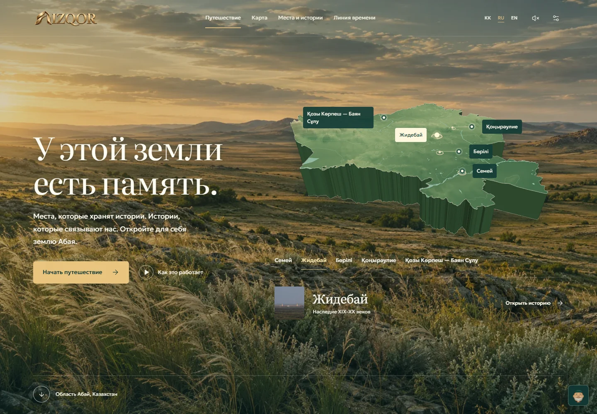
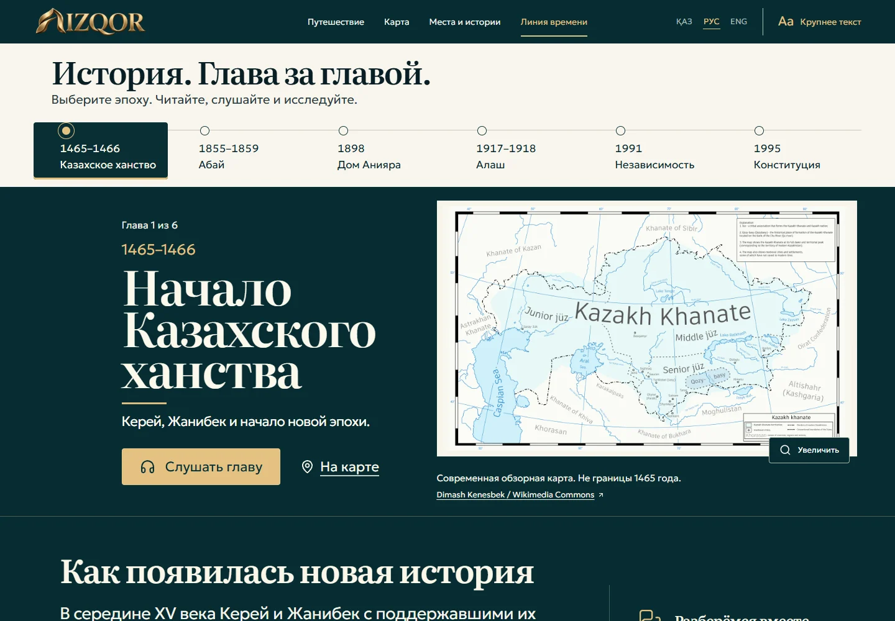

<div align="center">


# Память места. Истории людей.

**Интерактивное путешествие по области Абай.**

Исследуйте ландшафт, знакомьтесь с историей мест и задавайте вопросы проводнику Жолсерік.

[Открыть сайт](https://izqor-abai.vercel.app) · [Запустить локально](#запуск-на-компьютере) · [Подключить ключи](#подключение-карты-и-ai-гида) · [Документация](#документация)

[](https://github.com/dimik98330/izqor-abai/actions/workflows/ci.yml)




*Семей · Жидебай · Бөрілі · Қоңырәулие · Қозы Көрпеш — Баян Сұлу*

</div>

## О проекте

IZQOR объединяет карту региона, пять историй мест, шесть глав истории Казахстана и разговорного AI-гида. Материалы сопровождаются источниками; легенды, иллюстрации и архитектурные схемы обозначены отдельно.

Интерфейс и истории доступны на **казахском, русском и английском** языках. Сохранённые места, прогресс чтения и настройки остаются в браузере. База данных для запуска не нужна; медиа, шрифты и подготовленные геоданные уже включены.

> [!TIP]
> **Сначала можно запустить без ключей.** Главная 3D-сцена, истории и линия времени будут доступны. Для карты останется список мест, а гид предложит справочные материалы вместо AI-ответов. Ключи можно добавить позже.

## Запуск на компьютере

### 1. Подготовьте программы

Установите [Node.js](https://nodejs.org/en/download) **ветки 22.x, не ниже 22.12**, и [Git](https://git-scm.com/downloads/). npm устанавливается вместе с Node.js. После установки откройте новое окно PowerShell или терминала и проверьте:

```bash
node --version
npm --version
git --version
```

В первой строке должна быть версия `v22.12.0` или новее в ветке 22.x. Если используете менеджер версий Node, нужная ветка указана в `.nvmrc`.

### 2. Скачайте проект

В терминале выполните:

```bash
git clone https://github.com/dimik98330/izqor-abai.git
cd izqor-abai
```

Можно также нажать **Code → Download ZIP** на GitHub и распаковать архив. Затем откройте терминал внутри распакованной папки — там, где лежит `package.json`.

### 3. Установите зависимости и запустите сайт

```bash
npm ci
npm run dev
```

Откройте **[http://127.0.0.1:5173](http://127.0.0.1:5173)** в браузере. Окно терминала оставьте открытым: в нём работает локальный сервер. Чтобы остановить сайт, нажмите **Ctrl+C**.

На этом запуск без ключей завершён. Для полноценной карты и AI-ответов выполните следующий раздел.

## Подключение карты и AI-гида

Нужны два разных ключа: **2GIS — для карты**, **OpenAI — для ответов гида**. Можно подключить только один сервис. Для просмотра материалов ключи не обязательны.

### 1. Создайте два локальных файла настроек

В корне проекта, рядом с `package.json`, скопируйте шаблоны.

**Windows · PowerShell:**

```powershell
Copy-Item .env.example .env.local
Copy-Item .env.server.example .env.server.local
```

**macOS / Linux:**

```bash
cp .env.example .env.local
cp .env.server.example .env.server.local
```

> [!NOTE]
> Копирование требуется только при первой настройке. Если эти файлы уже существуют, отредактируйте их: повторное копирование заменит сохранённые значения.

Результат должен выглядеть так:

```text
izqor-abai/
├── .env.local             ← настройки карты и адрес API
├── .env.server.local      ← секретный ключ AI-гида
├── .env.example           ← шаблон клиента, хранится в Git
├── .env.server.example    ← шаблон сервера, хранится в Git
├── package.json
├── src/
└── server/
```

На Windows файлы можно открыть командами `notepad .env.local` и `notepad .env.server.local`. Проверьте, что редактор не добавил расширение `.txt`.

### 2. Вставьте ключ 2GIS в `.env.local`

Получите браузерный ключ в [личном кабинете 2GIS](https://platform.2gis.ru/) с доступом к **Map Tiles API**, который используется MapGL. Порядок получения ключа описан в [официальной инструкции](https://docs.2gis.com/en/mapgl/start/first-steps).

Содержимое **`.env.local`**:

```dotenv
VITE_GUIDE_ENDPOINT=/api/guide
VITE_2GIS_API_KEY=PASTE_YOUR_2GIS_BROWSER_KEY_HERE
```

Замените `PASTE_YOUR_2GIS_BROWSER_KEY_HERE` своим ключом. Это браузерный ключ карты: он используется клиентом и виден браузеру. Если у ключа настроены ограничения по адресам, разрешите адрес, с которого открываете сайт. Для работы карты нужен доступ к сети.

Если карта 2GIS пока не нужна, оставьте `VITE_2GIS_API_KEY=` пустым. Локальная 3D-сцена на главной работает отдельно от 2GIS.

### 3. Вставьте ключ OpenAI в `.env.server.local`

Создайте собственный API-ключ на странице [OpenAI API keys](https://platform.openai.com/api-keys). Учётная запись API должна иметь доступ к выбранной модели и доступный лимит использования.

Содержимое **`.env.server.local`**:

```dotenv
OPENAI_API_KEY=PASTE_YOUR_OPENAI_API_KEY_HERE
OPENAI_MODEL=gpt-5.4-mini
GUIDE_WEB_SEARCH=true
```

Замените `PASTE_YOUR_OPENAI_API_KEY_HERE` своим ключом. `OPENAI_MODEL` — модель, используемая обработчиком; выше указано текущее значение по умолчанию в проекте. `GUIDE_WEB_SEARCH=false` отключает веб-поиск гида.

Если AI пока не нужен, оставьте `OPENAI_API_KEY=` пустым. Чтобы вообще не обращаться к API гида, дополнительно задайте `VITE_GUIDE_ENDPOINT=` в `.env.local`.

> [!IMPORTANT]
> **Ключ OpenAI хранится только на сервере.** Не вставляйте его в `VITE_2GIS_API_KEY`, `VITE_GUIDE_ENDPOINT` или переменные с префиксом `VITE_`: они попадают в клиентскую сборку. Локальные `.env` исключены из Git; в репозитории хранятся только пустые шаблоны. Реальные запросы к AI и использование карты зависят от условий и лимитов провайдеров.

### 4. Перезапустите сервер и проверьте результат

Остановите предыдущий запуск через **Ctrl+C**, затем выполните:

```bash
npm run dev
```

- Откройте **Карту**: при действующем ключе 2GIS должна загрузиться интерактивная карта.
- Откройте [статус API гида](http://127.0.0.1:5173/api/guide/status). Поле `configured: true` означает, что сервер увидел непустой ключ; корректность ключа и доступ к модели проверяются первым ответом гида.
- Откройте **Жолсерік** и задайте вопрос, например: «Расскажи об Абае». При доступном API появится AI-ответ. Такой запрос обращается к платному провайдеру.

После изменения серверных настроек нужен перезапуск. После изменения `VITE_*` для собранной версии нужна повторная сборка.

## Проверка и готовая сборка

Выполняйте команды в корне проекта:

| Команда | Что произойдёт |
| --- | --- |
| `npm ci` | Установятся версии зависимостей из `package-lock.json`. |
| `npm run dev` | Запустятся сайт и API для разработки на порту **5173**. |
| `npm run check` | TypeScript проверит типы. |
| `npm test` | Запустятся тесты с подменённым AI-провайдером, без платных запросов. |
| `npm run build` | Создастся клиентская сборка в `dist/`. |
| `npm start` | Запустятся просмотр готовой сборки и API на порту **4173**. Требуется предварительная сборка. |

Для просмотра готовой версии:

```bash
npm run build
npm start
```

Откройте **[http://127.0.0.1:4173](http://127.0.0.1:4173)**. Команды `dev` и `start` — два альтернативных локальных режима; одновременно запускать их не требуется.

В [GitHub Actions](.github/workflows/ci.yml) настроены установка, проверка типов, тесты и сборка. Цвет значка CI в начале README отражает результат последнего удалённого запуска.

## Если что-то не работает

| Проблема | Что проверить |
| --- | --- |
| `node` или `npm` не найдены | Установите Node.js и откройте новый терминал. Проверьте `node --version` и `npm --version`. |
| PowerShell запрещает запуск `npm.ps1` | Используйте `npm.cmd ci` и `npm.cmd run dev`. Менять системную политику выполнения не требуется. |
| `npm ci` не находит `package.json` | Перейдите в папку проекта командой `cd izqor-abai` либо откройте терминал рядом с `package.json`. |
| Ошибка версии Node.js | Выберите Node.js 22.x версии 22.12 или новее. |
| Порт 5173 или 4173 занят | Остановите прежний запуск в его терминале через Ctrl+C. В проекте включён строгий выбор порта. |
| 2GIS не загружается | Проверьте ключ в `.env.local`, доступ к Map Tiles API, ограничения адреса, сеть и поддержку WebGL. Список мест остаётся доступным. |
| Гид отвечает в справочном режиме | Проверьте `.env.server.local`, непустой `OPENAI_API_KEY`, адрес `/api/guide` в `.env.local` и перезапуск сервера. |
| API сообщает об авторизации, модели или квоте | Проверьте ключ, доступ к модели и лимиты в аккаунте провайдера. `configured: true` сам по себе их не подтверждает. |
| Изменения `.env` не применились | Перезапустите сервер. Для готового сайта заново выполните `npm run build`. |
| Настройки сохранены, но ключ не читается | Убедитесь, что файлы находятся рядом с `package.json` и называются точно `.env.local` и `.env.server.local`, без `.txt`. |

Не открывайте `index.html` двойным щелчком: приложение работает через локальный сервер по адресу выше.

## Что можно исследовать

| Раздел | Возможности |
| --- | --- |
| **Живой ландшафт** | Трёхмерная сцена области с границами, рельефом и выбором мест. |
| **Исторический атлас** | Карта 2GIS, поиск, фильтры и доступный список мест. |
| **Истории мест** | Пять подробных историй с фотографиями, документами и источниками. |
| **Линия времени** | Шесть глав: от Казахского ханства до Конституции. |
| **Жолсерік** | AI-диалог с трёхмерным проводником, выбором языка и ссылками на источники. |
| **Музейные впечатления** | Внешние панорамы и учебная 3D-схема мавзолея Қозы Көрпеш — Баян Сұлу. |
| **Личная коллекция** | Сохранённые места и запись воспоминания на микрофон с локальным скачиванием. |
| **Комфорт чтения** | Размер текста, контраст, уменьшение движения, звук и вводное знакомство. |

<details>
<summary><strong>Посмотреть линию времени</strong></summary>



</details>

## Размещение в интернете

**Рабочий сайт: [izqor-abai.vercel.app](https://izqor-abai.vercel.app).** Клиент и API гида размещены на Vercel. Первый деплой выполнен через официальный CLI; автоматическое размещение после push пока требует подключения GitHub к аккаунту Vercel.

Для Vercel в репозитории подготовлены `vercel.json` и функции `api/guide.ts`, `api/guide/status.ts`. `npm start` предназначен для локального просмотра сборки.

1. Импортируйте `dimik98330/izqor-abai` в Vercel и выберите бесплатный Hobby для личного некоммерческого проекта.
2. Оставьте корневую папку `./`, Node.js **22.x** и пресет **Vite**. Установка `npm ci`, сборка `npm run build`, выходная папка `dist` заданы в `vercel.json`.
3. В **Environment Variables** добавьте `VITE_2GIS_API_KEY`, `VITE_GUIDE_ENDPOINT=/api/guide`, `OPENAI_API_KEY`, `OPENAI_MODEL=gpt-5.4-mini` и `GUIDE_WEB_SEARCH=true`. Ключ OpenAI — серверная переменная без префикса `VITE_`.
4. Выполните Deploy. После изменения переменных нужен новый деплой. Проверьте главную, `#/map`, `#/timeline` и `/api/guide/status` на выданном домене.

На Vercel клиент и API работают на одном домене. Локальные `.env` не загружаются: значения нужно задать в настройках проекта Vercel.

- Для статического хостинга публикуется папка `dist/`. Hash-маршруты (`#/map`, `#/timeline`) не требуют серверных rewrite-правил.
- В подпапке сайта нужно задать Vite `base` перед сборкой. Пример для Bash: `npm run build -- --base=/izqor-abai/`.
- **Загрузка только `dist/` не запускает сервер гида.** При импорте всего репозитория Vercel отдельно собирает функции из `api/`; на другом статическом хостинге потребуется собственный Node.js-обработчик по тому же origin.
- Переменные на хостинге задаются через его настройки. Серверный `OPENAI_API_KEY` не должен попадать в клиентские переменные `VITE_*`.
- Внешние карты, панорамы и AI требуют сети. Полноценный запуск без интернета не заявлен.

Подробный контракт API и ограничения запросов: [Guide integration](AGENT_INTEGRATION.md).

<details>
<summary><strong>Стек и структура проекта</strong></summary>

**React 19 · TypeScript · Vite 8 · Three.js · 2GIS MapGL · Motion · Lucide · Vitest · Node.js**

```text
src/
  App.tsx                   Маршруты, язык и состояние приложения
  HomeJourney.tsx           Вход в путешествие
  RegionScene.tsx           Локальная сцена региона
  Atlas.tsx                 Карта 2GIS
  TimelinePage.tsx           Исторические главы
  GuidePanel.tsx             Интерфейс беседы
  GuideAvatar.tsx            Трёхмерный проводник
  content.ts                Места и основные источники
  i18n.ts                   Переводы интерфейса
  story-chapters-*.ts        Истории на трёх языках
server/
  guide.ts                  Валидация, источники и запросы к AI
  vite-guide.ts             API для dev / preview
public/                     Медиа, шрифты, модели и геоданные
scripts/                    Необязательная подготовка геоданных
tests/fixtures/             Данные для проверки контента
docs/                       Документация и снимки интерфейса
```

Готовые ресурсы входят в репозиторий. Скрипты повторной подготовки геоданных не нужны для обычной установки, тестов и сборки. Для отдельного запуска `prepare-abay-elevation.mjs` нужен пакет `sharp`, а для `prepare-abay-water.mjs` — `@mapbox/vector-tile` и `pbf`.

</details>

## Документация

| Документ | Содержание |
| --- | --- |
| [Guide integration](AGENT_INTEGRATION.md) | HTTP API, архитектура и ограничения AI-гида. |
| [2GIS map](docs/2gis-map.md) | Настройка карты и обработка ошибок. |
| [Media credits](MEDIA-CREDITS.md) | Авторы, источники и условия использования медиа. |

## Источники и права

Фотографии, документы, геоданные, шрифты и анимации сохраняют собственные условия использования и атрибуцию. Подробности — в [MEDIA-CREDITS.md](MEDIA-CREDITS.md) и файлах лицензий внутри `public/fonts/`.

Для двух издательских фотографий (`borili.jpg`, `konyr.jpg`), иллюстрации на основе первой фотографии и встраивания панорам остаются неподтверждённые условия повторного использования. Необходима проверка прав или замена соответствующих материалов. Для собственного кода лицензия пока не выбрана; публичный доступ к репозиторию сам по себе не предоставляет открытую лицензию.
